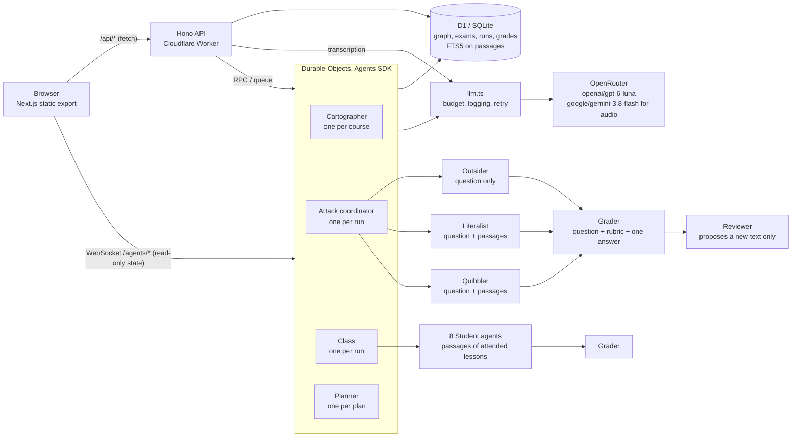

# PRISMA

> **Status, 14/11/2026.** Build finished and merged on `main`: course graph, triple attack with rewrite and re-attack, simulated class, recorded lesson, student view, study plan. Runs locally with `wrangler dev` and online at https://ai-on-campus.martesai.workers.dev (v1 deployed at 16:00 from `main`; the API asks for a demo code). Hand-in documents: this README, [`docs/architecture.md`](docs/architecture.md), [`docs/interaction-examples.md`](docs/interaction-examples.md). Pitch material in [`pitch/`](pitch/). Agent rules for this workspace: [`AGENTS.md`](AGENTS.md) (Italian).

**Every exam question, tested from three sides before the exam.**

PRISMA takes a university course (slides, notes, lesson transcripts), turns it into a graph of concepts with the slides behind each one, and lets the teacher attack a draft exam question with three agents before it reaches students: one answers without the course, one answers only from the course, one looks for a second reading. A Grader scores every answer against the teacher's rubric, a Reviewer proposes a rewrite, and the teacher decides.

## The problem and who pays

Writing a written exam question takes a teacher hours, and today nobody can tell before the exam whether a general-purpose model answers it without having followed the course, whether the course material actually supports the expected answer, or whether a sentence can be read in two ways. Teachers find out while grading, when it is too late.

PRISMA is a **B2B product**: a university, a department or a degree programme buys it. Teachers use it to prepare assessments; students use the read-only side (the course graph and a study plan). The case-study direction is **Assessment**, with a Teaching side (what the class did not get) and a Learning side (study plan).

## What it does

| Screen | What happens | Who does the work |
|---|---|---|
| Graph (`/`) | Concepts of the course, colour by topic, relations by type; tap a concept to read its definition, relations and the slides it comes from ("L08 · slide 67"). The teacher can rename or delete a wrong concept | Cartographer (live uploads); initial ontology imported |
| Materials (`/materials`) | Upload a `.md` or `.txt` lesson; the graph grows live while the Cartographer reads it | Cartographer |
| Exam (`/exam`) | Write a question with a rubric; "Attack the question": three attacks in parallel, grades per criterion, scorecard with verdicts, proposed rewrite; approve, edit or keep; re-attack; before and after | Outsider, Literalist, Quibbler, Grader, Reviewer |
| Class (`/class`) | Eight synthetic students answer the question, each with only the passages of the lessons they attended; distribution of grades and which lessons and concepts explain the lost points | Student agents, Grader |
| Lessons (`/lessons`) | Mark lessons as done; record up to 3 minutes of a lesson, get a transcript, send it to the Cartographer | Transcriber, Cartographer |
| Study (`/study`, student role) | Days left and what you already know; the backend orders the concepts from the graph and splits them into sessions, the Planner explains each session and points to slides | Planner |

The verdicts are computed by the backend from the grades, with fixed wording: "This model clears the pass mark without the course materials", "Insufficient evidence in the retrieved passages", "Candidate ambiguity", "No counterexample found", "Incomplete analysis". The best possible outcome is "No counterexample found"; PRISMA never certifies a question.

## Architecture in brief

One Cloudflare Worker serves the API, the agents and the static frontend. Details, boundaries and data model: [`docs/architecture.md`](docs/architecture.md).



- **Frontend:** Next.js 16 (App Router, static export), TypeScript, Tailwind 4, shadcn/ui, `react-force-graph-2d` for the graph. It talks only to `/api` through `app/frontend/lib/api.ts`.
- **Backend:** Hono 4 on Cloudflare Workers, `zod` for every request body, Cloudflare Agents SDK (`agents` 0.33) on Durable Objects. The agents push their state to the browser over WebSocket, so the jury sees who is working and the text as it is written.
- **Data:** D1 (SQLite), schema only in `app/backend/migrations/` (0001 ontology, 0002 exam with FTS5, 0003 class, 0004 lessons, 0005 study plan).
- **Retrieval without embeddings:** FTS5 full-text search with terms extracted by the model, plus the evidence slides of the concepts named in the question and of their first-degree neighbours in the graph. Every retrieved passage carries why it was picked (term, concept, graph edge), and the interface shows that path.
- **Models:** all through OpenRouter, behind one module (`app/backend/src/llm.ts`). `openai/gpt-6-luna` for every agent; `google/gemini-3.8-flash` only to transcribe the recorded lesson (it accepts audio). Every call has `max_tokens`, is reserved against a daily cap before it starts and logged in `model_calls` with its real cost.

## The case study, level by level

| Level | What the case study asks | What is actually there |
|---|---|---|
| 1 | A real problem in teaching, learning or assessment; 60-second pitch | Assessment: testing exam questions before the exam. Pitch and video in `pitch/` |
| 2 · real material | University content, not only model knowledge | The 13 lectures of a real master's course in Reinforcement Learning (867 slides). The slides belong to the teacher, so they stay outside Git (`materiale-locale/`); the teacher's name is redacted at ingestion (`REDACT_TERMS`) and never stored |
| 2 · an action | At least one action beyond replying | Builds the graph in D1; runs attacks, grades per criterion, verdicts; proposes a rewrite; creates question versions on the teacher's decision; runs the class; transcribes a lesson into the graph; builds a study plan |
| 2 · boundaries | Stays on the line; guardrails in code | Only the teacher's decision creates a question version; no rubric, no attack (422); each agent's context is built by a function that receives only what it may see; student role read-only on the server; the Planner cannot query exam or class tables; citations verified as substrings; totals and verdicts computed in code. See `docs/architecture.md` |
| 3 · A, multi-agent | Specialised agents, compared and combined, human control | Three attackers with distinct perspectives on the same question, a blind Grader, a Reviewer that combines the outcomes, and the teacher as the decision point (approve, edit, keep). There is no adaptive interview agent: the "clarification" is a hard stop (no rubric, no attack) |
| 3 · B, knowledge graph | Ontology, populated graph, graph-grounded agent, says when the graph lacks the answer | Ontology: course → topic → concept, five relation types (`prerequisito`, `parte_di`, `generalizza`, `usa`, `contrasta`), evidence slides on every concept. 179 concepts, 342 relations in the demo course. Retrieval and the study plan follow graph edges and show the path; "Insufficient evidence in the retrieved passages" when retrieval finds nothing or the Literalist finds the passages not enough, and then the Reviewer proposes no rewrite. Concepts editable by the teacher |
| 3 · C, launch campaign | Name, tagline, channels, timing | Name and tagline only. No channel plan or calendar |

**How the graph was built and checked.** The initial ontology of the demo course was extracted beforehand by a more capable model (Claude) and imported through `POST /api/courses/:id/ontology`, which applies the same validation as the Cartographer: a concept without an evidence slide is dropped, a slide without extracted text does not count as evidence, a relation with an unknown endpoint is rejected. On import, 37 evidence references were rejected, all for slides without extracted text. Anything uploaded from the app is read live by the Cartographer with `openai/gpt-6-luna`. In the pitch the starting graph is presented as prepared beforehand, not as Luna's output.

## Run it locally

Requirements: Node.js (tested with 23) and an OpenRouter key. On 14/11/2026 these steps were run on a fresh worktree, on port 8792 instead of 8787, with the `--ontologia` seed; the seed without `--ontologia` was not rerun that day.

```bash
# 1. dependencies
cd app/backend && npm install
cd ../frontend && npm install

# 2. secrets (never committed): app/backend/.dev.vars
#    OPENROUTER_API_KEY=sk-or-...
#    DAILY_BUDGET_USD=0.30          # optional, default 1.50
#    REDACT_TERMS=Name,Surname      # optional, terms removed from uploaded material
#    DEMO_CODE=...                  # optional; if set, every /api route except /api/health asks for it

# 3. build the frontend: the Worker serves app/frontend/out
cd ../frontend && npx next build

# 4. local database and Worker
cd ../backend
npx wrangler d1 migrations apply aoc-db --local
npx wrangler dev --port 8787            # open http://localhost:8787

# 5. seed (another terminal, in app/backend)
node scripts/seed.mjs <folder with .md lessons> --api http://localhost:8787               # each lesson read by the Cartographer
node scripts/seed.mjs <folder with .md lessons> --api http://localhost:8787 --ontologia   # or: lessons without extraction + <folder>/ontologia.json
node scripts/seed-esame.mjs --api http://localhost:8787     # mock exam with questions A, B, C
node scripts/seed-classe.mjs --api http://localhost:8787    # eight synthetic students
```

For frontend work with hot reload: `cd app/frontend && npx next dev --port 3000` (it reads `NEXT_PUBLIC_API_BASE=http://localhost:8787` from `.env.development`). To reset the local database: `rm -rf app/backend/.wrangler/state` and apply the migrations again.

The course material is not in the repository. To try PRISMA, use your own lessons as Markdown (`## Slide N` headings give slide-level locators; otherwise Markdown headings and paragraph blocks). `seed-esame.mjs` writes three Reinforcement Learning questions: they make sense only with an RL course.

The demo path in a real browser, only when asked: `npm run e2e` from the repository root (Playwright, desktop 1440 × 900 and phone 390 × 844), or `DEMO_URL=<url> npm run e2e`.

## Simulated, synthetic, real

**Simulated** (approved before the build, declared in the interface):

- **Login and roles.** A role selector sends `x-role: studente` (WebSocket: `?role=studente`). The server enforces it: with that header every write except the study plan, and every read of exams, runs, class and usage, answers 403. But the role comes from the client: without the header the caller is the teacher. It stands in for the university login; it is not authentication. The optional `DEMO_CODE` protects a public URL; it is not a login either.

**Synthetic** (data invented, stored in D1 by seed scripts, processed for real):

- The eight students of the class: invented names, grade averages, study styles and attended lessons. They are model agents with limited access to the passages of their lessons, not a prediction of real grades.
- The three mock-exam questions and their rubrics.

**Real:** every model call, the course material, the graph in D1, retrieval, grades, verdicts, versions, transcription, the live state over WebSocket. No route returns fixed data, no model output is hand-written.

## Measured costs

From `model_calls` on a local run of 14/11/2026, `openai/gpt-6-luna` at $0.10 / $0.50 per million tokens in / out.

| Operation | Calls | Cost | Time |
|---|---|---|---|
| Triple attack (terms, 3 attacks, 3–4 grades, Reviewer) | 7–9 | $0.0006–0.0019 | 10–24 s |
| Simulated class, 8 students (terms, 8 answers, 8 grades) | 17 | $0.0031 | 13 s |
| Study plan, 2 sessions | 2 | $0.0013 | 3 s |
| Cartographer on a short source (2–4 slides) | 1–2 | $0.0003–0.0004 | a few seconds |
| Cartographer on a full lecture (phase 02 measure) | 3–4 | $0.002–0.004 | 20–50 s |
| Transcription of 57 s of audio, `google/gemini-3.8-flash` (phase 04 measure) | 1 | $0.0020 | 4 s |

All the examples in `docs/interaction-examples.md` together, in two sessions: 96 calls, $0.0187. Reading the whole 13-lecture course with the Cartographer costs about $0.04.

## Honest limits

- **The agents know the subject anyway.** "Limited access to the course passages" limits what the Literalist, the Students and the Planner receive, not what the model already knows. On a standard calculation (question A) almost every student scores full marks even without the right lessons.
- **The verdicts depend on one model.** "Clears the pass mark without the course materials" is about `openai/gpt-6-luna`; a stronger or weaker model may score differently. The Quibbler does not always find the same ambiguity on the same text: that is why it is a "candidate" left to the teacher.
- **Retrieval is lexical.** FTS5 plus graph edges, no embeddings: a passage phrased with different words can be missed, which is why the verdict says "in the retrieved passages" and not "not in the course".
- **Prompt injection** is contained, not impossible: untrusted text is fenced and no agent has tools, but a model can still follow an injected sentence. What limits the damage is in code: JSON schemas, evidence and citation checks, totals and verdicts computed by the backend, and no agent can write a question version.
- **Not deployed.** The remote D1 database does not exist yet (`database_id` placeholder in `wrangler.jsonc`).
- **Real microphone not verified end to end**; the recorded lesson was tested with Chromium's fake microphone and synthetic speech.
